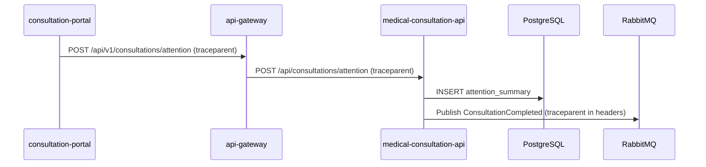

# Critical Journey: Record medical attention

## Hop Table
| Step | Caller | Receiver | Protocol | Operation | Sync/Async | Data |
|---|---|---|---|---|---|---|
| 1 | consultation-portal | api-gateway | REST | POST /api/v1/consultations/attention | sync | none |
| 2 | api-gateway | medical-consultation-api | REST | POST /api/consultations/attention | sync | JWT, traceparent |
| 3 | medical-consultation-api | PostgreSQL | TCP | INSERT attention_summaries | sync | medical_consultation schema |
| 4 | medical-consultation-api | RabbitMQ | AMQP | ConsultationCompleted event | async | traceparent in headers |

## Sequence Diagram

## Span Tree
* [Root] POST /api/v1/consultations/attention (Gateway)

    * [Child] POST /api/consultations/attention (Medical Consultation API)

        * [Child] DB Query INSERT attention_summary

        * [Child] Publish Event ConsultationCompleted (Asynchronous boundary)