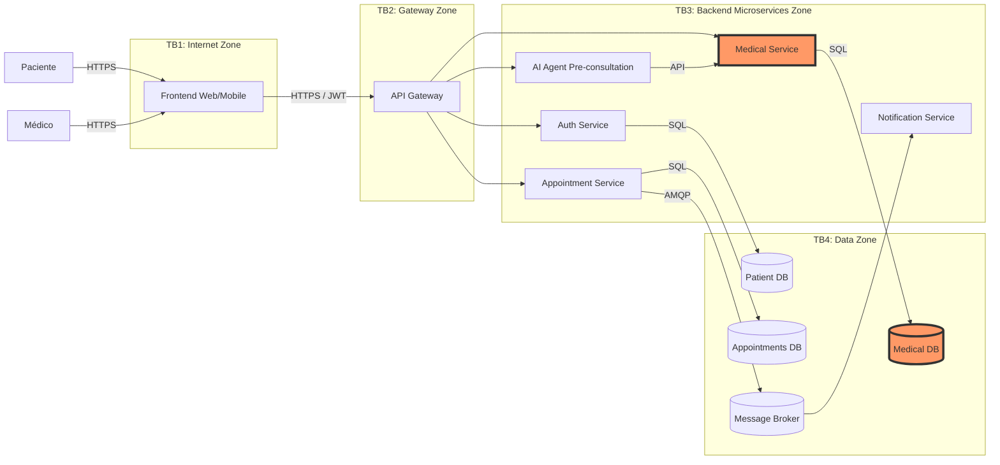

# Attack Surface Map - Telemed-IA

## 1. Data Flow Diagram

**Note:** My claimed trust boundary is TB4 (Backend -> Database), specifically between the `Medical Service` and the `Medical DB`.

---

## 2. Asset Inventory

| Asset | Where it lives | Classification |
|---|---|---|
| Patient Vitals (HU-012, HU-014) | Medical  DB | Confidential |
| Medical Care Summary PDFs (HU-016) | Medical  DB | Confidential |
| Patient Credentials / Auth Tokens | Users DB | Restricted |
| Appointment Schedules | Appointments DB | Internal |
| AI Pre-consultation Symptoms (HU-006) | AI Service / Transit | Confidential |

---

## 3. Entry Points of My Boundary (Backend to Database)

| Entry Point | Type | Who calls it | Authentication Today |
|---|---|---|---|
| `GET /api/v1/medical/{id}/summary` | REST Endpoint | Medical Service | JWT (Gateway validates, service trusts) |
| `POST /api/v1/medical/vitals` | REST Endpoint | Medical Service | JWT (Gateway validates, service trusts) |
| `SELECT/INSERT` on `public` | Database Port (e.g., 5432) | Medical Service | DB User/Password via environment variables |